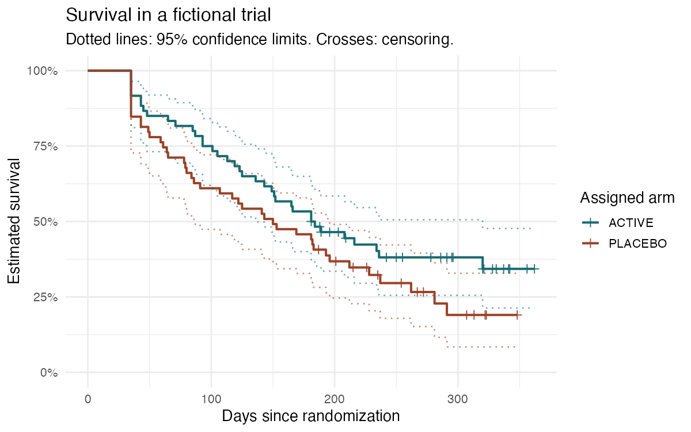

I built a clinical-trial data pipeline because I wanted one example where I could follow a study record all the way to a survival chart.

The project creates a fictional two-arm trial, sorts the records into standard study tables, and checks them for mistakes. It turns problems into questions for review instead of quietly changing the data. I can then export a form definition for REDCap, a research data-collection tool, and run an analysis of time to death in R.

**Every record is generated. There is no real patient data.** The treatment difference is fictional, and the results are not medical evidence.

To try the full example on macOS:

```sh
brew install uv r pandoc
uv python install 3.12
make setup
make demo
make check
open build/demo/output/data_quality.html
open build/analysis/report.html
```

`make demo` needs a fresh `build/demo` directory. For another run, use `uv run clinical-pipeline demo --output build/another-run`, then `Rscript analysis/render.R build/another-run/output/sdtm build/another-report`. On Linux, install R and Pandoc with your package manager and install [uv](https://docs.astral.sh/uv/getting-started/installation/), then use the same make commands.

## What comes out

The default run starts with 120 fictional subjects and three visits each. I planted five mistakes: an unsupported sex code, an implausible blood pressure, a missing lab unit, an event ending before it starts, and a negative dose. The pipeline raises five open queries, quarantines 16 records, and releases 119 subjects for the survival analysis.



A survival curve estimates how many subjects remain alive as follow-up progresses. Crosses mark subjects whose later outcome is unknown. The separation between these curves comes from the generator's settings.

| Output | What I use it for |
| --- | --- |
| `build/demo/source/` | Original fictional records, left unchanged |
| `build/demo/output/query_log.csv` | Review questions, values, rules and exact source rows |
| `build/demo/output/data_quality.html` | Readable summary of errors and exclusions |
| `build/demo/output/sdtm/` | Released study tables for analysis |
| `build/demo/output/redcap_dictionary.csv` | Field names, forms, choices and validation rules |
| `build/demo/output/redcap_records.csv` | Coded records with repeated visits kept separate |
| `build/demo/output/roundtrip_sdtm/` | Tables recovered from that CSV using the dictionary |
| `build/demo/output/define.xml` | Variable descriptions, origins and allowed values |
| `build/analysis/report.html` | Demographics, survival curves, adjusted model and assumptions |

I included [a sample query log](examples/query_log.csv), [quality report](examples/data_quality.html), [REDCap dictionary](examples/redcap_dictionary.csv) and [rendered analysis](examples/report.html). Download the HTML files and open them locally. Each CI run also saves the full generated dataset and reports as a downloadable artifact.

## How the records move

CDISC SDTM is a standard way to organize study records into tables called domains. I map the source files into DM (demographics), VS (vital signs), LB (laboratory tests), AE (adverse events), EX (treatment exposure), and DS (study disposition, including death or last contact).

The [mapping specification](docs/mapping_spec.csv) describes every output variable. For example, glucose collected in mg/dL becomes mmol/L by dividing by 18.0182. I keep both results and units, flag results outside the example's reference range, and check the conversion. The [design notes](docs/design.md) explain why I used a generated trial, and [the data guide](docs/data-guide.md) covers the terminology and review rules.

Each query stays OPEN. A bad DM or DS record excludes that subject across all released tables. Other errors exclude the affected record. The original mapped rows stay in `staging/`, and `quarantine.csv` records every exclusion. This is a review queue, not an automatic claim that the study is ready to lock.

The REDCap dictionary uses numeric choice codes and one form per domain. I export records, read the written dictionary and records back, and reconstruct the study tables. The run fails if any released value changes. This is an offline compatibility check; I have not tested an import into a live REDCap installation. [The REDCap guide](docs/redcap.md) explains the repeat-form setup and a manual sandbox check.

## How I analyze the trial

The R code uses tidyverse for data preparation and survival for Kaplan-Meier estimation and a Cox proportional-hazards model. The endpoint is elapsed days from randomization to death or last contact. A subject alive at last contact is right-censored: I know they survived that long, but not what happened afterward.

The Cox model compares assigned arms while adjusting for age and sex. The report includes confidence intervals, numbers at risk and a proportional-hazards diagnostic. It rejects duplicate or missing endpoints, inconsistent dates and invalid covariates. Open queries on safety records do not disappear just because an endpoint analysis can run.

## Reproduction and limits

The default seed is 2026. `--clean` generates the same kind of trial without planted errors; `--subjects` and `--seed` allow other cohorts. Input files and the mapping specification get SHA-256 fingerprints in `manifest.json`. The report records its R and package versions in the report and `session-info.txt`.

The output is an educational SDTM subset in CSV, with Define-XML-style metadata. It is not a complete, schema-certified Define-XML package, an ADaM analysis submission, or a regulator-validated study. Event terms are fictional reported text, not licensed MedDRA coding. The local terminology lists cover this example rather than every published CDISC term. R packages are installed from CRAN; the recorded session versions help explain differences between environments.

## Code and checks

`clinical_pipeline/spec.json` drives the mapping documentation, dictionary and metadata. The Python modules handle generation, mapping, review and export; `analysis/` contains the R functions, tests and report template. Python dependencies are locked in `uv.lock`.

GitHub Actions runs Python 3.12 and R 4.5.2, both test suites, the complete trial pipeline, report rendering and artifact checks. Locally, the suite has 28 Python tests and 9 R tests with 28 passing expectations. Run `make test` after `make demo`, or `make check` to also render and inspect all required artifacts.
